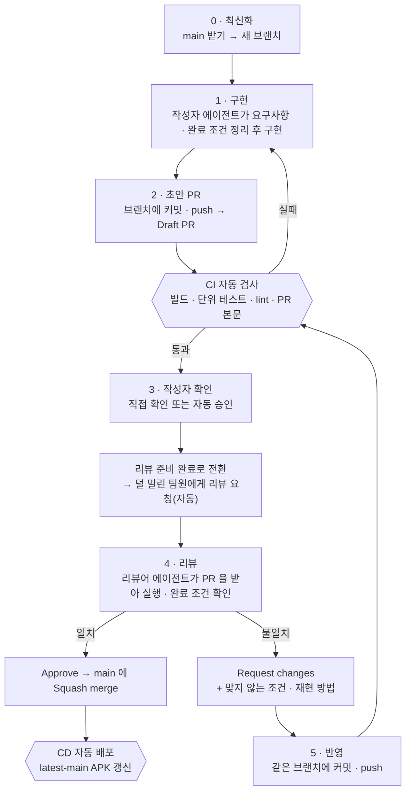

# 개발 흐름 (3인 · AI 에이전트 · 상호 리뷰)

각자 자기 파트를 AI 에이전트에게 지시해 만들고, 다른 팀원의 에이전트가 **직접 실행해 보고** 리뷰한다.
코드는 PR 로만 main 에 들어간다. 에이전트가 지킬 세부 명령은 [CLAUDE.md](CLAUDE.md) 에 있다.



## 역할

| 누가 | 하는 일 |
|---|---|
| 작성자 (사람) | 에이전트에게 지시, 정리된 요구사항 · 완료 조건 확인, 리뷰 보내기 전 동작 확인 |
| 작성자 에이전트 | 최신화, 구현, 로컬 빌드 · 실행, 브랜치에 커밋 · push, PR 작성, 피드백 반영 |
| 리뷰어 에이전트 | PR 을 받아 빌드 · 설치 · 실행, 완료 조건 하나씩 확인, 코드 읽기, 판정 · 합치기 |
| 리뷰어 (사람) | 에이전트의 판정을 보고 제출 승인 (자동 제출로 둘 수도 있음) |
| GitHub Actions | CI 검사, 리뷰어 자동 지정, main 이 바뀌면 APK 배포 |

## 단계

### 0. 최신화 (모든 작업의 시작)
`main` 을 받고 거기서 새 브랜치를 만든다. 브랜치 이름: `<GitHub아이디>/<기능번호>-<짧은-영문-설명>` (예: `youngbeen/f1-tire-alert`).
작업 중에 다른 사람 PR 이 main 에 합쳐지면 `git merge origin/main` 으로 내 브랜치에 반영한다.

### 1. 구현
에이전트는 지시를 **요구사항**(무엇을)과 **완료 조건**(리뷰어가 실행해서 확인할 동작)으로 먼저 정리해 작성자에게 확인받고 구현한다.
완료 조건은 "Virtual Console 에서 오른쪽 뒷바퀴 공기압을 낮추면 카드가 '주의'로 바뀌고 안내 음성이 나온다"처럼 **실행해서 참/거짓을 가릴 수 있게** 쓴다.

### 2. 초안 PR
작성자 에이전트가 자기 브랜치에 커밋 · push 하고 **Draft PR** 을 연다. 본문은 PR 템플릿(요구사항 · 완료 조건 · 확인 방법)을 채운다.
PR 이 열리면 CI 가 자동으로 돈다. CI 가 빨간불이면 리뷰를 보내지 않는다.

### 3. 작성자 확인 → 리뷰 요청
작성자가 동작을 확인하면(또는 자동 승인 설정이면) PR 을 **리뷰 준비 완료(Ready for review)** 로 바꾼다.
그러면 Actions 가 나머지 두 명 중 한 명에게 리뷰를 요청한다(GitHub 알림 · 메일로 감). 리뷰 순서는 모두 같다.
고르는 기준: ① 지금 밀려 있는 리뷰가 적은 사람 → ② 같으면 내 직전 PR 을 리뷰하지 않은 사람(번갈아) → ③ 그래도 같으면 `.github/reviewers.txt` 에 먼저 적힌 사람.
지정된 사람이 바쁘면 다른 사람이 대신 리뷰해도 된다(`gh pr edit <N> --add-reviewer <아이디>`).

### 4. 리뷰
리뷰어 에이전트는 PR 브랜치를 받아(`gh pr checkout`) 빌드 · 설치하고 **완료 조건을 하나씩 실행**해 본다. 그리고 코드 변경을 읽는다.

- **일치** → Approve 하고 main 에 **Squash merge**, 브랜치 삭제. (리뷰어가 따로 커밋하지 않는다. 코드는 이미 작성자가 push 했다.)
- **불일치** → Request changes. 본문 형식:

  ```
  ### 맞지 않는 완료 조건
  - 조건 2: (조건 내용)
    - 재현: 1) … 2) …
    - 기대: … / 실제: …
    - 근거: 스크린샷 · logcat 일부
  ### 꼭 고칠 코드
  - app/src/…/Foo.kt:42 — 이유
  ### 참고 (안 고쳐도 됨)
  ```

- 실행하지 못한 조건(에뮬레이터 문제 등)은 통과로 치지 않고 "실행 못 함"으로 적고 사람에게 묻는다.
- PR 이 main 보다 뒤처져 있으면 `gh pr update-branch` 로 맞추고 CI 가 다시 통과한 뒤 합친다. 충돌이 나면 작성자에게 넘긴다.

### 5. 피드백 반영
작성자 에이전트가 리뷰 내용을 읽고 **같은 브랜치에** 고쳐서 push 한다(PR 이 자동 갱신되고 CI 가 다시 돈다).
PR 에 "반영 내역" 댓글을 남기고 3번으로 돌아가 같은 리뷰어에게 다시 요청한다.

### CD
main 에 합쳐질 때마다 Actions 가 디버그 APK 를 만들어 **`latest-main` 릴리스**에 올린다.
최신 main 을 에뮬레이터에 깔고 싶으면:

```bash
gh release download latest-main -p "*.apk" --clobber
adb install -r app-debug-*.apk
```

앱마켓 제출용 서명 빌드는 제출 직전에 따로 만든다.

## 사람별 자동 승인 설정

저장소 루트에 `CLAUDE.local.md` 를 만들어 둔다(git 에 올라가지 않는다). 없으면 둘 다 "끄기"로 본다.

```markdown
# 내 설정
- GitHub 아이디: my-github-id
- 리뷰 요청 자동 전송: 끄기   <!-- 켜기: 구현 · 자체 확인 · CI 가 끝나면 묻지 않고 리뷰를 요청한다 -->
- 리뷰 결과 자동 제출: 끄기   <!-- 켜기: 검증이 끝나면 묻지 않고 Approve · merge 또는 Request changes 를 보낸다 -->
```

## 규칙

- main 에 직접 커밋 · push 하지 않는다. (`git config core.hooksPath .githooks` 로 막아 둔다)
- 남의 PR 브랜치에 push 하지 않는다. 고칠 점은 리뷰로 전한다.
- 한 PR = 한 가지 동작. 크면 나눈다. PR 제목 형식: `[기능N] 한 일` (Squash merge 하면 이 제목이 main 커밋 제목이 된다).
- 다른 사람 파트 파일을 고쳐야 하면 PR 본문에 적고 그 사람을 리뷰어로 추가한다.
- API 키 같은 비밀 값은 `secrets.properties`(git 제외)에만 둔다. CI 에 필요하면 GitHub Secrets 로.
- Pleos SDK AAR 은 디컴파일하지 않는다(42dot 라이선스 3.4). API 는 공식 문서 · 샘플 · 컴파일 오류로 확인한다.
- 요구사항의 기준은 [docs/기능계획서.pdf](docs/기능계획서.pdf) 다. 계획과 다르게 만들면 PR 본문 '범위 밖' 에 적는다.
